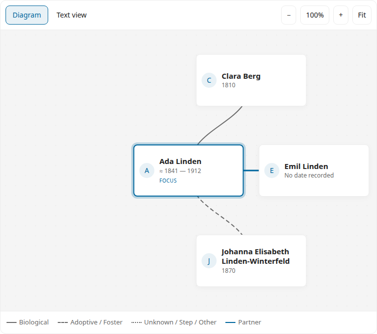
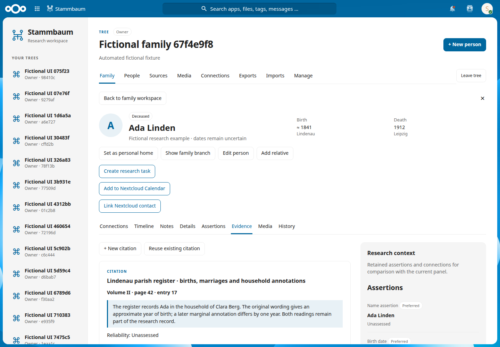
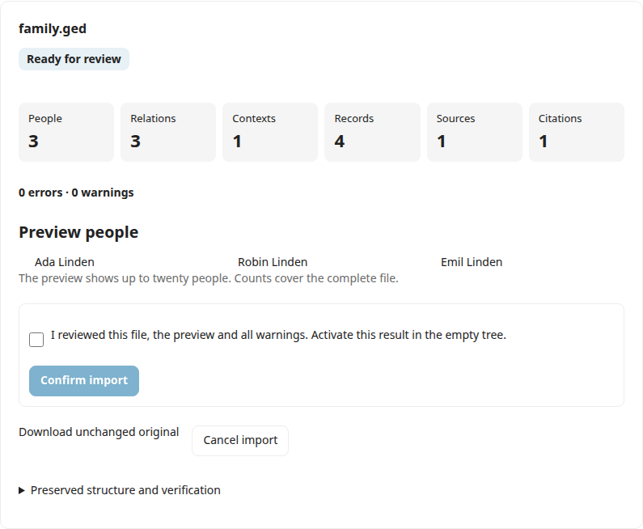

# Nextcloud Stammbaum

Stammbaum is a native Nextcloud app for private, collaborative family-history research. The current **0.1.0-alpha.34** development version is for testing and feedback. [Release 0.15 parity](docs/implementation-roadmap.md) and production recovery are still in progress.



*An interactive family branch. The diagram also has a text alternative and keyboard controls.*

## What works today

- Create private trees and invite members. Tree roles, export grants and record visibility are independent of Nextcloud administrator status.
- Record people, relationships, family contexts, historical dates, sources, citations, shared events, notes and competing assertions.
- Explore a bounded family diagram, expand local relatives, search and review evidence, and keep personal saved views.
- Upload JPEG, PNG and PDF originals, or review a private copy from Nextcloud Files. Add descriptive dates, places, events and people shown or mentioned; create portraits and attachments separately. Previews and thumbnails stay private. PDF previews need optional Poppler utilities.
- Review and activate supported GEDCOM imports into an empty tree. Generate privacy-filtered current-state GEDCOM exports, with optional unchanged originals in a ZIP package.
- Review media deletion and restore retained originals from media trash.
- Optionally create reviewed Tasks and Calendar entries, and privately link Contacts cards. These apps are not required for genealogy.



*Evidence remains alongside the person's assertions and family context.*



*The import preview appears before activation.*

## Build and test

The current development target is **Nextcloud 34**, **PHP 8.3+** and **MariaDB**. Node 24 and npm 11 are used to build the app; Nextcloud needs no Node process at runtime.

```sh
npm ci
npm run check
npm run format:check
npm run package
```

The package and SHA-256 sidecar are written to `build/`. The archive contains one `stammbaum/` runtime directory. The [operations guide](docs/operations.md) covers installation and the disposable test fixture. The [recovery exercise](docs/operations.md#consistent-recovery-boundary) verifies that a backup preserves fictional research and original files, and that restored credentials, invitations and exports lose their authority. The [platform adaptation](docs/platform-adaptation.md) records the verified compatibility matrix.

## Scope and limitations

GEDCOM import and export use [documented bounded profiles](docs/gedcom-import-profile.md); unsupported input may block activation and export reports omissions. The app does not claim unrestricted round trips, populated-tree merge, a portable lossless archive or complete release-0.15 parity. Generated exports expire after 24 hours and become invalid after relevant tree or access changes. Media originals remain private app data and continue to count toward quota while in trash.

Nextcloud accounts provide sign-in and account administration. Optional Tasks, Calendar and Contacts actions require their own review and retain each destination app's permissions. See the [integration concept](docs/nextcloud-integration-concept.md) and [current API contract](docs/integration-api-contract.md).

The [scoped credential foundation](docs/operations.md#scoped-credential-foundation) provides issuance and revocation through authenticated browser routes. The account UI and external bearer API are still in progress.

The [implementation roadmap](docs/implementation-roadmap.md), [open issues](https://github.com/utrost/Nextcloud-Stammbaum/issues) and [alpha.33 acceptance evidence](docs/core-closeout-alpha33.md) describe remaining work and executed checks. The [archived initial specification](docs/intial-spec/current-product-specification.pdf) is the source handoff; its `intial-spec` spelling is intentional.

All screenshots above come from automated fictional fixtures. Do not commit real family records, credentials or local deployment configuration. Stammbaum is licensed under [AGPL-3.0-or-later](LICENSE); runtime dependency notices are in [THIRD-PARTY-NOTICES](THIRD-PARTY-NOTICES).
