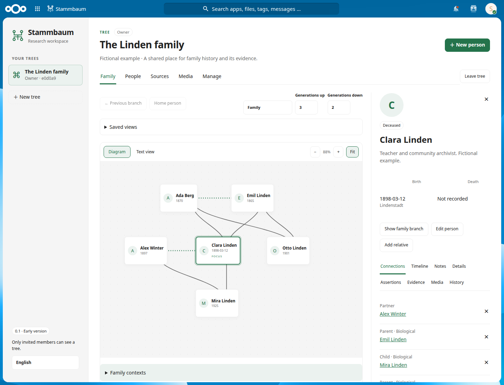

# First iteration — 6 November 2026

Version **0.1.0-alpha.7** is the first native implementation. It provides a usable manual research workflow. It is not complete release-0.15 parity, and broad implementation issues remain open until their full acceptance criteria are met.

## Implemented slice

| Area | Behavior delivered | Backlog coverage, still partial |
| --- | --- | --- |
| Platform | Native Nextcloud app, versioned MariaDB migrations, deterministic runtime package, test fixture and CI workflow | F01–F05, I08 |
| Access | Private trees, four roles, separate export grants, explicit 48-hour invitations, revocation, self-leave, last-owner checks and account lifecycle invalidation | A01–A05 |
| People | Unknown defaults, typed historical dates/places, retained alternative assertions, assessments, preferred values and privacy-preserving release of current values | G01–G03 |
| Family | Explicit parent/partner relationships, biological-cycle checks, atomic relative creation, ordered sibling/family contexts and inactive relationship history | G04–G05 |
| Evidence | Searchable source library, reusable citations, person/assertion/relationship/record/context targets, target-specific effects and independent detachment | G06–G07 |
| Research | Shared repeated events, participant confirmation, timelines, safe notes, preferred biography, confidential contacts and ordered structured fields | G08–G10 |
| Workspace | Paginated people and detail sections, bounded family/ancestor/descendant diagrams, text alternative, focus/selection separation, camera controls, 30-state branch history and personal named views | A07, W01–W04 |
| Editing/history | Draft-preserving failures and conflict comparison, guarded navigation, person history, deletion impact review, latest-100 trash and restoration without reactivating connections | W05–W07 |
| Media | Validated private JPEG/PNG/PDF uploads, unchanged originals, checksums, quota reservations, person assignments, portraits and reversible crops | F04, M01–M02 |
| Delivery | English/German UI and persisted language, mobile controls, security/browser tests and explicit recovery-authority invalidation command | I04–I08 |

The archived specification remains unchanged after its earlier relocation and image-reference repair. The 60 published issues still match `backlog.json`; no priority or acceptance requirement was removed to match this alpha.

## Verification

The isolated environment is Nextcloud **34.0.4.1**, PHP **8.5.10** and MariaDB **11.8.9**, with Chrome **148.0.7778.167** browser automation. PHP 8.3 syntax is checked separately. Application tests use fictional records and native Nextcloud accounts; the outsider account is a host administrator to exercise the absence of an administrator bypass.

The regression suite covers:

- Cross-tree and record privacy, hidden shared dependencies, safe original/preview access, CSRF and stale writes.
- Idempotent creates, last-owner and role boundaries, reviewed invitation acceptance, explicit revocation and account disable/password/deletion/recreation events.
- Retained historical assertions, dates, biological loops, atomic relative rollback and restoration without resurrecting relationships.
- Shared events on both participant timelines, original wording after correction, safe note formatting and confidential structured details.
- Source/citation reuse and detachment; context ordering without invented parents.
- Media byte integrity after crops and detachment; upload type/size/dimension bounds; interruption accounting, revoked-and-regranted upload authority and quota enforcement.
- Personal saved-view privacy, language persistence, draft retention across language changes and navigation, failure/retry states, desktop, 390px and 320px workflows.
- A 451-person fictional family exercising the 200-person/400-neighbor/20-context projection boundaries and a stale deletion-impact review.
- The recovery invalidation command preserving memberships and completed originals while revoking restored invitation authority.

Final local result: **39 integration/browser tests passed**, with zero failures, skips or retries, in 5.1 minutes. Three JavaScript unit tests and the PHP historical-date/person checks passed. PHP 8.3 syntax, metadata/routes, formatting, runtime dependency audit and archive/backlog checks passed. The 451-person bounded graph plus first people page completed in 156 ms in this fixture; that single measurement is not a production performance certification.

The exact runtime package SHA-256 is `03a775765e2dd36e6a63efe3fa0f341c3ab9a371d740c734e3041ade586f80d6`. It upgraded the isolated fixture and installed freshly on Alice's Nextcloud **34.0.3.2 / PHP 8.5.10**. The shared-instance browser smoke verified native login, an empty account, tree/person creation, authorized reads and no browser errors. Its temporary account and fictional genealogy rows were removed afterward.

Alice remained healthy with maintenance off. Library **0.4.0-alpha.2** and Relate (`utrost_inventory`) **0.28.1-alpha.1** retained their versions and enablement. No Alice pre-deployment backup was created, following the user's development-system instruction. No broader tests or recovery invalidation command were run on the shared installation.

The CI workflow is configured; remote results are reported separately after it runs.

[Evidence workspace screenshot](screenshots/iteration-01-evidence.png). Both screenshots use a dedicated fictional family in the isolated fixture.

## Explicit remaining work at the end of iteration 1

The subsequent [GEDCOM iteration](iteration-02.md) adds a bounded parser and durable reviewed import. The following records the alpha.7 boundary, not the current alpha.8 feature list.

GEDCOM parsing/preservation, reviewed atomic import activation, current-state export, expiring export jobs, ZIP/media matching, scoped external credentials, integration APIs, webhooks and a complete durable-job subsystem are **not implemented**. No parser/export compatibility or full backup restoration is claimed. Those remain F06, M03–M08 and I01–I03/I06 work with their original priority.

The current manual model also leaves work inside existing issues: richer provenance and assertion authoring, contradiction findings, precise citation target editing across all paginated records, broader source metadata, complete read/access audit views, event/family-context origins, media assignments beyond people, EXIF-aware previews, retained-original cleanup, personal default home, local neighborhood expansions, pinch gestures, full browser history semantics and durable cross-session draft recovery. Stored notes, contacts and media are not a substitute for the specified import mappings.

The diagram uses a simple deterministic layout; family-context recorded order is explicit in its text representation. The source/record conflict panels currently show structured current data for deliberate comparison. English/German text exists, but full translation and accessibility certification remain open. No screen-reader certification, all-browser certification or production throughput target is claimed.

The alpha adds conservative editing bounds: 32 event participants, structured fields, citation targets or media assignments; 400 context members; 30 named views per user/tree; 200 loaded assertions per person. These are implementation limits, not changes to the original product obligations. Tree/membership lists, assertion pagination and globally serialized writes require further scale work.

Deleting an account revokes its grants; host-forced removal of the final owner does not automatically give a host administrator access. A deliberate operator ownership-recovery workflow remains unfinished. Pending media reservations remain retained and counted; no purge command is supplied.

Deferred obligations in D01–D12 remain separate from parity completion. Public discovery, external matching and geocoding services remain excluded boundaries, not new implementation promises.
