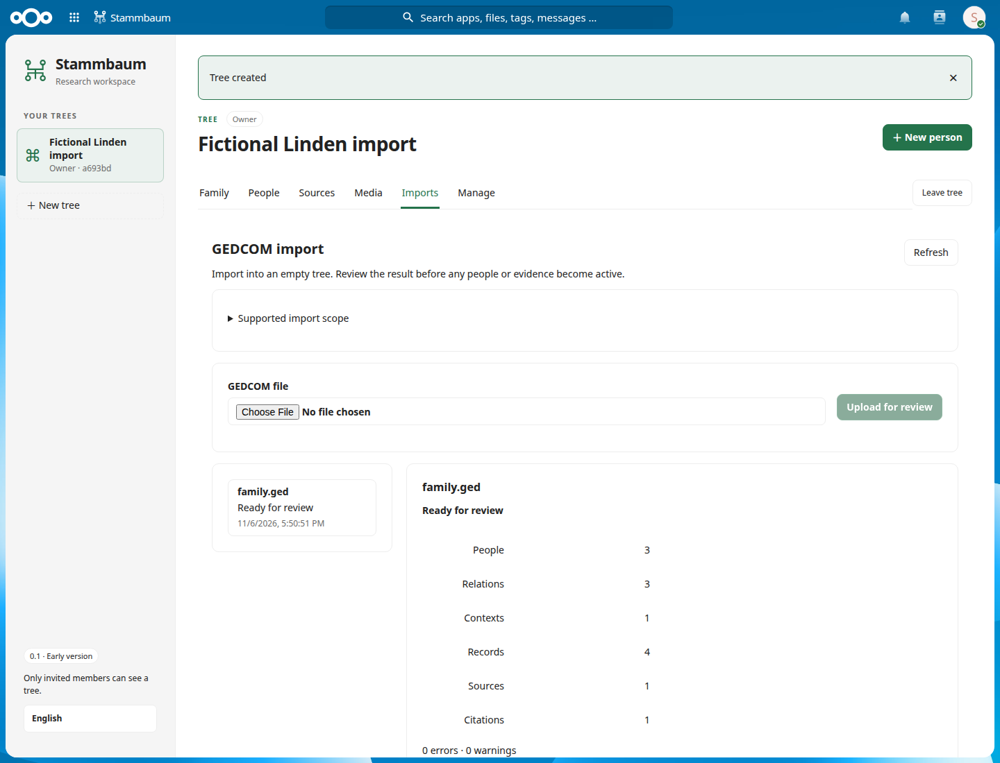

# Second iteration — reviewed GEDCOM import

Version **0.1.0-alpha.8** adds a native manager-only GEDCOM journey: upload an unchanged original, wait for analysis, review diagnostics and a preview, explicitly confirm the exact result, then activate it atomically in an empty tree. The work builds on [the manual research iteration](iteration-01.md).

The named profile **`nc-gedcom-551-alpha1`** is a bounded subset, with an explicit [support matrix and retention contract](gedcom-import-profile.md). Basic people, historical dates/places, explicit family membership, partnership assertions, notes, sources and citations become editable research. Unsupported standard fields block activation; vendor extensions remain preserved with warnings. No full M2a–M2d compatibility, current-state export or release-0.15 parity is claimed.

## Delivered contracts

| Backlog | Implemented increment | Remaining boundary |
| --- | --- | --- |
| [F06 #7](https://github.com/utrost/Nextcloud-Stammbaum/issues/7) | Durable import states, bounded cron/CLI worker, lease fencing, recovery, cancellation, current-account/generation checks and transactional publication | General export/integration job system and richer progress remain unfinished |
| [M04 #35](https://github.com/utrost/Nextcloud-Stammbaum/issues/35) | Versioned strict GEDCOM 5.5/5.5.1 reader, UTF-8/ASCII/BOM UTF-16, preserved bytes/hierarchy/offsets, bounded work and original download | Broader profile evolution/consumer verification remains unfinished |
| [M05 #36](https://github.com/utrost/Nextcloud-Stammbaum/issues/36) | Closed semantic whitelist, immutable source-line maps, exact supported citation targets, conservative privacy and honest bounded diagnostics | Cumulative M2a–M2d names/events/contacts/repositories/media/adoption mappings remain core work |
| [M06 #37](https://github.com/utrost/Nextcloud-Stammbaum/issues/37) | Manager-only upload/review/raw/original/confirm/cancel, deduplication, review hashes/revisions, empty-tree checks, persistent quotas and atomic activation | Complete acceptance with the full mapping profile remains unfinished |

The UI uses Nextcloud sessions and CSRF. An unrelated Nextcloud administrator has no genealogy access. English/German import screens distinguish upload, analysis, review, activation, failure and cancellation; they never show an invented progress percentage. Original downloads are labeled explicitly and do not claim current-state export.

Three new tables hold runs, ordered nodes and mappings. Private originals live in `IAppData/imports`. Failed/cancelled reservations remain counted; there is no automatic purge or misleading restart button. The existing recovery-authority command also invalidates pending imports through membership generations.

## Verification record

The implementation is tested with fictional fixtures in the isolated Nextcloud/MariaDB environment. The import tests cover review bindings and idempotency, private reports/raw/originals, unsupported fields, revoked-and-regranted authority, stale destinations, cancellation, expired leases, real database rollback faults, parallel workers, concurrent readers, original corruption, rate/quota/pending capacity, the 2,000-person limit and native cron execution from the browser journey.

Local verification: **54 integration/browser tests passed** with zero failures, skips or retries in 8.0 minutes. After a final canonical-partnership ordering correction, all **15 import tests passed again** in 2.6 minutes. The final 2,000-person analysis/review/activation fixture took 4,505 ms; this single fictional measurement is not a production throughput guarantee. Three JavaScript unit tests, PHP date/person checks, GEDCOM encoding/semantic/resource-boundary tests, PHP 8.3 syntax, formatting, runtime dependency audit and documentation/archive checks passed.

The exact runtime package SHA-256 is `71fb878344a45c93025700eccb6c3586326b8f03aa3b5706765d73a4da368ba8`. It upgraded the isolated Nextcloud 34.0.4 / MariaDB fixture and Alice’s Nextcloud **34.0.3.2 / PHP 8.5.10**. Alice’s authenticated smoke used a temporary ordinary Nextcloud account and the actual HTTP origin. Normal host background processing analyzed the file and activated three fictional people only after explicit review. The unchanged original download and imported-family view passed without browser errors. Its temporary account, genealogy/import rows and original file were removed afterward.

An existing long-lived host worker initially could not load the new job and removed its registration. Its installed cooperative signal handling was inspected, then the identified idle worker was gracefully reloaded with the same arguments. Cron scheduling was unchanged. Deployment now resolves and idempotently verifies the app’s declared jobs in a fresh process; the missing-job repair was also exercised in the disposable instance. See [operator instructions](operations.md) for the host-worker boundary.

Alice remained healthy with maintenance off and no database upgrade pending. Library **0.4.0-alpha.2** and Relate **0.28.1-alpha.1** retained their versions and enablement. No development-system backup was created. Fault injection, quota manipulation and concurrency tests ran only in the isolated fixture.

All 59 work-issue titles, bodies and milestones still match `backlog.json`, with the roadmap tracker making 60 issues total. The original 100 archive hashes, local HTML assets and A01–A30 coverage checks pass. Fresh remote CI results are reported on the draft PR after execution.

## Scope retained

No issue specification, original priority, A01–A30 mapping or archived source document is weakened to match this increment. The original 60-issue backlog remains authoritative. Original-file download does not implement [M07 current-state export](https://github.com/utrost/Nextcloud-Stammbaum/issues/38), [M08 export jobs](https://github.com/utrost/Nextcloud-Stammbaum/issues/39), ZIP/media matching, scoped external credentials, integration APIs, webhooks, portable archives or full operational recovery.

The original private-storage reservation limits and global write guard remain conservative alpha choices. The advertised import bounds are exercised in a fictional fixture; production throughput, universal consumer interoperability and broad accessibility certification are not claimed.
